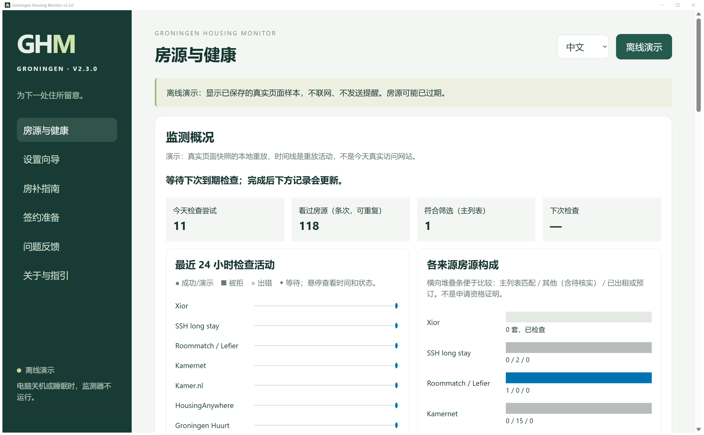
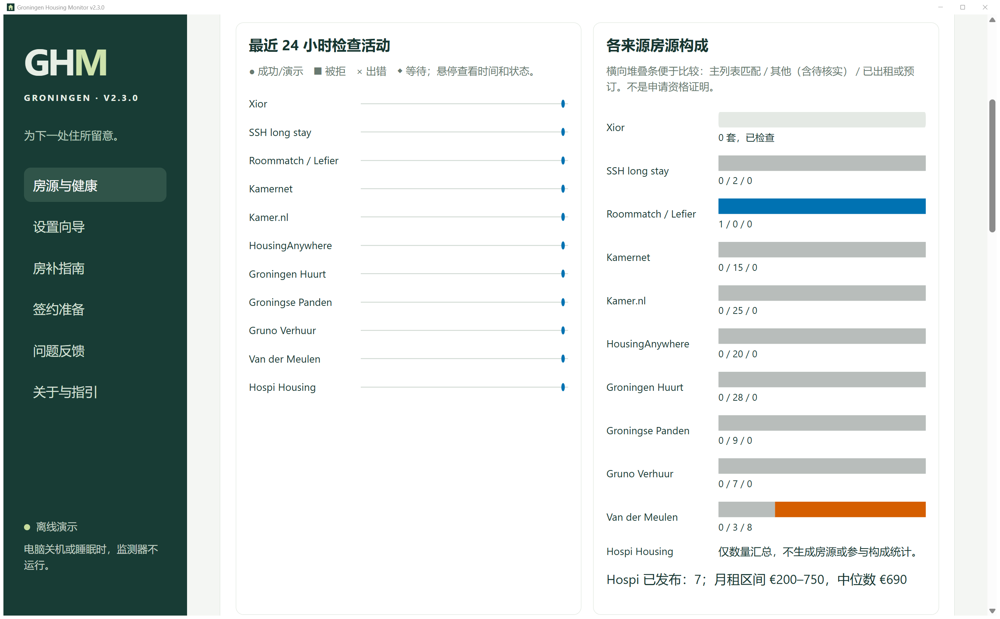
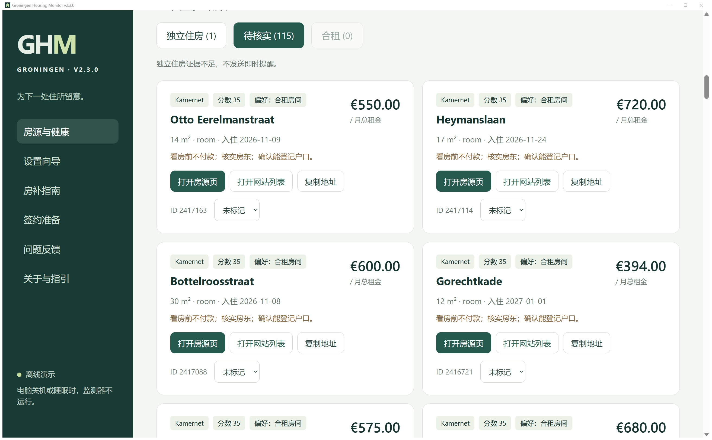
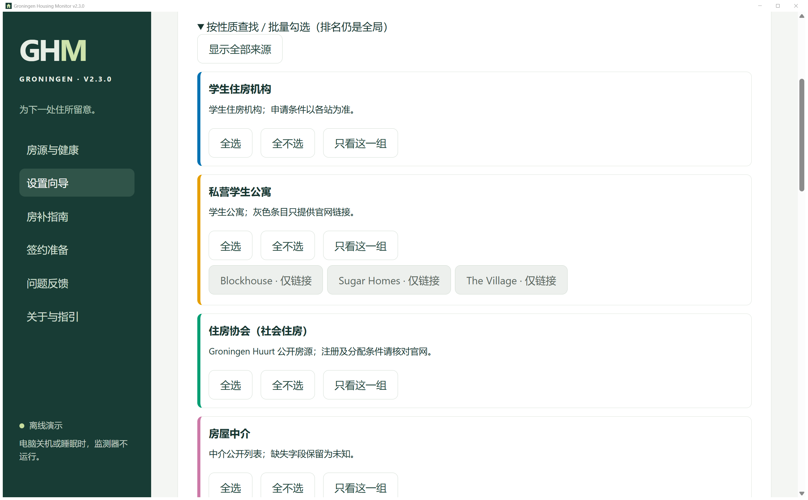
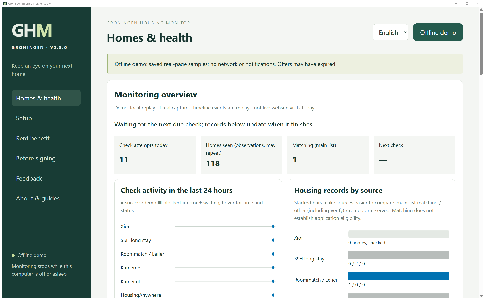

# Groningen Housing Monitor（格罗宁根租房提醒）

一个桌面程序：在后台定时查看 Groningen 各类租房网站的**公开房源**，有符合条件的新房源就提醒你。

它只负责提醒，不会自动登录、申请、签约或付款，也不会绕过验证码或网站限制。看到提醒后，订房、联系房东都由你自己在官网完成。

> 旧版 Python 脚本（只查 Xior）仍在 Releases 的“租房脚本-v1”里。新版是装好就能用的程序，不需要 Python。

## 下载

最新版：**v2.3.0**，在本仓库的 [Releases](https://github.com/NagisaUtada/Xior-Housing/releases) 页面下载：

| 文件 | 给谁用 |
|---|---|
| `GroningenHousingMonitor-v2.3.0-Setup.exe` | **Windows 10 / 11**：双击安装即可使用 |
| `GroningenHousingMonitor-v2.3.0-mac-source.zip` | **Mac**：源码编译包。目前没有现成的 Mac 安装包，用它可以在你自己的 Mac 上编出 `.dmg` 安装包，功能与 Windows 版相同。包里附有逐步说明（`在Mac上编译-步骤.md`），大约需要 1 小时 |
| `SHA256SUMS.txt` | 两个文件的校验值，下载后可核对文件是否完整、未被改动 |

安装包没有 Windows 发布者证书。Windows 如果提示“已保护你的电脑 / 未知发布者”，请先核对下载文件的 SHA256 与 `SHA256SUMS.txt` 一致，再决定是否点“更多信息 → 仍要运行”。程序内部的文件有签名校验，被改动过会显示“非官方修改版”。

更新说明见 [`CHANGELOG.md`](CHANGELOG.md)。

## 能做什么

- **查哪些网站**（按性质分组，可一键全选）：
  - 学生住房机构：SSH 长租、SSH 短租、Roommatch / Lefier、DUWO
  - 私营学生公寓：Xior；Blockhouse、Sugar Homes、The Village 提供官网链接
  - 住房协会（社会住房）：Groningen Huurt（Lefier、Nijestee、De Huismeesters、Patrimonium、Woonborg、Wierden en Borgen 等）
  - 房屋中介：Groningse Panden、Gruno Verhuur、Van der Meulen；Rotsvast 提供官网链接
  - 房源平台：Kamernet、Kamer.nl、HousingAnywhere
  - 寄宿家庭：Hospi Housing（显示在出租数量和租金区间）
  - 只保留 Groningen 市的房源；用 ↑ ↓ 排先后，排在前面的网站房源在列表和提醒里也靠前
- **看得见软件在工作**：监测概况里有最近 24 小时的检查时间线、各网站房源构成和租金分布，即使暂时没有空房，也能看到每次检查都在进行
- **房源卡片**：一键“打开房源页”（网站有单独页面时）、“打开网站列表”（房源下架后也能用）、“复制地址”（复制后可直接到网站搜索）
- **每个网站单独设置**：点哪个网站，下方就显示它的检查频率、注意事项和网站内偏好（房型顺序、区域关键词）；Xior 还可以勾选和排序楼盘
- **提醒方式**（可以同时用）：
  - 电脑桌面通知（一直开着）
  - 有新房源时，立即在本机邮件软件（Outlook 等）里弹出一封写好的提醒，不用密码，不会自动发出
  - 用你自己的邮箱给自己发邮件（需要授权码），手机也能收到
  - 手机推送（ntfy，可选，实验性）
- **后台运行**：点窗口右上角 × 只会收进右下角托盘，继续监测（Windows 11 可能收在“∧”里，可以拖到任务栏常驻）；开机后静默启动到托盘。要停止，右键托盘图标选“退出”
- **电脑睡眠**：监测期间默认不让电脑自动睡眠（屏幕照常关闭）。合上笔记本盖子或手动选“睡眠”仍会睡，醒来后会接着查
- **检查频率**：“省电 / 标准”两档，每个网站有固定的最短检查间隔，Xior 最快每 20 分钟查一栋楼，不会高频刷网站。遇到网站拒绝访问（403/429、验证码）会自动暂停，不绕过
- 界面随窗口大小缩放，宽屏下模块自动并排；中英文可切换；设置过程中没保存的内容会自动记住（不含密码）

| | |
|---|---|
|  |  |
|  |  |

截图来自程序的离线演示模式（重放已保存的真实页面），界面上标有“演示”。

## 使用提醒

- 提醒只说明“网站上出现了符合条件的房源”。付款或提交申请前，务必在官网核对楼栋、房型、日期、租金和个人信息。
- Kamernet、Kamer.nl、HousingAnywhere 上：看房前不付款，核实房东，确认能登记户口。
- Roommatch / Lefier 的学生房一般只租给在 Groningen 或 Leeuwarden 上学的人；Groningen Huurt 的住房协会房源需要先在该网站注册，部分只限青年或老年，请逐条核对房源条件。
- 卸载：先在托盘里退出程序，再到 Windows“设置 → 应用 → 已安装的应用”卸载。卸载会清除程序数据、系统凭据和自启项；已经发出的邮件和推送、系统通知历史等无法随卸载清除。

## 反馈

- 程序里的“问题反馈”页可以预览后发送，收件地址 ge.yan+ghm@rug.nl。不要填写密码、完整租约或证件信息，截图先打码。
- 也可以用你自己的邮箱直接发到上面的地址，**邮件标题必须以 `[GHM反馈]` 开头**，否则不会被处理。
- 或者在本仓库的 [Issues](https://github.com/NagisaUtada/Xior-Housing/issues) 里提问题。
